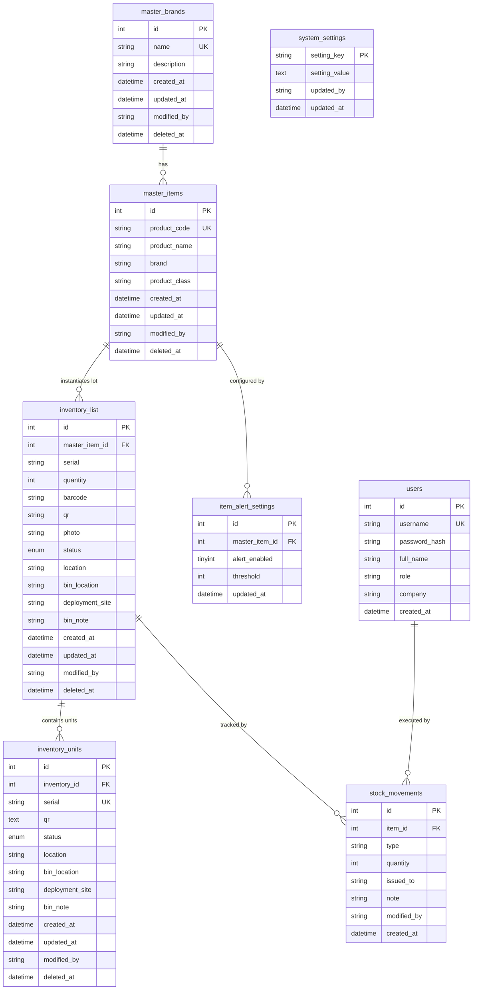

# Inventory Management System — Architecture & Codebase Context

An exhaustive technical reference and knowledge base for the **Inventory Management System** deployed at `C:/xampp/htdocs/inventory`.

---

## 1. Executive Summary & Tech Stack

This project is an enterprise-ready warehouse inventory and serialized asset tracking application designed to run on standard LAMP/WAMP/XAMPP stacks without requiring Node.js, frontend build steps, or external package managers.

### Core Technologies
- **Runtime / Language**: PHP 8.x
- **Database**: MySQL / MariaDB (via PHP PDO with prepared statements)
- **Frontend / Scripting**: Vanilla JavaScript (ES6+), custom CSS design system, HTML5
- **Third-Party Client Libraries**:
  - `JsBarcode.all.min.js`: Canvas-based 1D barcode rendering (CODE128, EAN-13)
  - `qrcode.min.js`: Client-side 2D QR code generation
  - `html5-qrcode.min.js`: Camera and file-based QR/barcode scanning via WebRTC
  - `xlsx.full.min.js`: Client-side spreadsheet parsing and Excel (.xlsx) export

### Directory Structure
```
C:/xampp/htdocs/inventory/
├── actions/             # POST/AJAX endpoints handling business mutations
├── css/                 # Global styles, variables, component sheets, print rules
├── img/                 # Application static assets and icons
├── includes/            # Shared logic, layout templates, partials, and data engines
├── js/                  # Reusable client modules (table engine, modals, scanner)
├── pages/               # Top-level view controllers loaded by users
├── uploads/             # User-uploaded item photos and receipt documentation
├── config.php           # DB credentials, dimension limits, base URLs, timezone
├── index.php            # Root router / redirect controller
├── login.php            # Authentication portal
└── logout.php           # Session invalidation controller
```

---

## 2. Database Schema & Data Model

The application relies on 8 tables in the `inventory_system` database. All foreign keys cascade or enforce logical integrity.

### Entity Relationship Diagram



### Table Details

1. **`master_brands`**:
   Catalog of product manufacturers/brands. Supports soft deletion (`deleted_at`).
2. **`master_items`**:
   The master product registry. Defines item names, 4-digit sequential product codes (`0001`, `0002` via `next_master_code()`), brand associations, and product classes (`Inventory Item`).
3. **`item_alert_settings`**:
   Configures low-stock alert thresholds for specific master catalog items.
4. **`inventory_list` (Lots / Batches)**:
   Represents physical stock batches.
   - `quantity`: Number of items in this lot.
   - `status`: `'available'`, `'taken'`, `'in_transit'`.
   - `deployment_site`: `"In Warehouse"`, `"In Transit"`, or the assigned customer name.
   - `location` / `bin_location`: Coordinates within warehouse shelving.
   - `barcode`: EAN-13 formatted string.
   - `deleted_at` / `bin_note`: Soft-delete staging in the Inventory Bin.
5. **`inventory_units` (Serialized Assets)**:
   Child units belonging to an `inventory_list` entry (`inventory_id`). Each unit holds a globally unique serial number (`serial`), its own location/deployment state, and individual QR payload.
6. **`stock_movements`**:
   Immutable movement log for audit trails.
   - Types: `'stock-in'`, `'stock-out'`, `'transfer'`, `'split'`, `'merge'`, `'restore'`.
   - Tracks destination / recipient (`issued_to`), operator (`modified_by`), and timestamps.
7. **`users`**:
   Authentication accounts with hashed passwords (`PASSWORD_BCRYPT`) and role strings.
8. **`system_settings`**:
   Key-value settings table.

---

## 3. Authentication, Security & Permissions

All authentication is centralized in [`includes/auth.php`](file:///C:/xampp/htdocs/inventory/includes/auth.php).

### Session & Reverse Proxy Handling
- Sessions are initialized with secure cookie parameters (`SameSite=Lax`, `HttpOnly=true`).
- Automatically detects HTTPS when running behind Cloudflare Tunnels, AWS ALB, or reverse proxies (`HTTP_X_FORWARDED_PROTO == 'https'`).

### Role-Based Access Control (RBAC)
Role hierarchy (lowest to highest):
1. `guest`: Read-only / disabled access.
2. `customer`: View assets deployed to their assigned company (`customer-assets.php`).
3. `technician`: Allowed stock movement operations (`movement.manage`).
4. `engineer`: Inventory lot modifications (`inventory.manage`, `movement.manage`).
5. `admin`: Master catalog editing + inventory management (`master.manage`, `inventory.manage`, `movement.manage`).
6. `super admin`: Full system privileges including user administration (`users.manage`) and hard-deletes (`permanent_delete`).

### Permission Mappings
```php
'super admin' => ['master.manage', 'inventory.manage', 'movement.manage', 'permanent_delete', 'users.manage']
'admin'       => ['master.manage', 'inventory.manage', 'movement.manage']
'engineer'    => ['inventory.manage', 'movement.manage']
'technician'  => ['movement.manage']
```

### CSRF Protection
- **Web Pages**: Includes `csrf_field()` (`<input type="hidden" name="csrf_token" value="...">`). Validated by `require_csrf()`.
- **AJAX Requests**: Header `X-CSRF-Token` or POST parameter `csrf_token`. Validated via `require_csrf_api()`.

---

## 4. Warehouse Coordinate System & Location Engine

### Coordinate Notation
Locations follow the standard warehouse grid format:
$$\mathbf{S\{shelf:02d\}-R\{row:02d\}-C\{col:02d\}}$$
- Example: `S01-R02-C03` denotes Shelf 1, Row 2, Column 3.
- Limits configured in [`includes/config.php`](file:///C:/xampp/htdocs/inventory/includes/config.php):
  - `SHELVES` = 5
  - `ROWS` = 5
  - `COLUMNS` = 5

### Location Classification (`classify_record_location`)
Items and units are logically partitioned into three location categories:
1. **Warehouse**: `deployment_site == 'In Warehouse'` or coordinate starts with `S`.
2. **Transit**: `deployment_site LIKE 'In Transit%'` or `status == 'in_transit'`.
3. **Customer**: Any external customer assignment name.

---

## 5. Barcode & Serial Number Generation

Located in [`includes/functions.php`](file:///C:/xampp/htdocs/inventory/includes/functions.php):

### EAN-13 Algorithm
Standard 12-digit prefix with modulo-10 weighted checksum ($1 \times \text{odd} + 3 \times \text{even}$):
```php
function ean13(string $digits12): string {
    $sum = 0;
    for ($i = 0; $i < 12; $i++) {
        $sum += (int)$digits12[$i] * ($i % 2 === 0 ? 1 : 3);
    }
    $check = (10 - ($sum % 10)) % 10;
    return $digits12 . $check;
}
```

### Serial Number Generation
- Individual units receive auto-generated serials if not provided during inbound intake:
  $$\text{SN-} + \text{strtoupper(bin2hex(random_bytes(4)))}$$ (e.g. `SN-A8B9C2D1`).
- Master product codes follow 4-digit zero-padded sequential values (`0001` through `9999`) guarded by MySQL table locks (`GET_LOCK('lock_master_product_code', 5)`).

---

## 6. Shared Table & AJAX Engine

Data presentation across the inventory catalog and stock movements is unified through [`includes/inventory-table.php`](file:///C:/xampp/htdocs/inventory/includes/inventory-table.php) and [`includes/inventory-data.php`](file:///C:/xampp/htdocs/inventory/includes/inventory-data.php).

### Supported List Modes
- `'list'`: Primary warehouse inventory view with edit, delete, split, merge, and import controls.
- `'stock-in'`: Uniform table displaying available stock lots with the stock-in autofill button.
- `'stock-out'`: Uniform table displaying available stock lots with the stock-out autofill button.
- `'transfers'`: Uniform table displaying available stock lots with the transfer autofill button.
- `'bin'`: Soft-deleted inventory lots awaiting restoration or permanent purging.
- `'generator'`: Barcode generation and label printing table.
- `'units'`: Granular unit-level inventory view with individual serial numbers.

### AJAX Flow
1. User filters, searches, or navigates pages in the frontend table.
2. [`js/table-grid.js`](file:///C:/xampp/htdocs/inventory/js/table-grid.js) sends an asynchronous request to [`actions/inventory-page.php`](file:///C:/xampp/htdocs/inventory/actions/inventory-page.php) with parameters:
   - `mode`, `page`, `size`, `q`, `sort`, `brand[]`, `shelf[]`, `row[]`, `col[]`, `location`.
3. `inventory-page.php` executes `inventory_fetch()` using SQL `LIMIT` & `OFFSET`.
4. Returns JSON:
   - `rows_html`: Pre-rendered HTML `<tr>` elements from `render_inventory_rows()`.
   - `rows`: Complete JSON payload of current page records for modal inspection.
   - `total`, `page`, `size`: Pagination controls state.

---

## 7. Business Workflows

### A. Stock In (Inbound Wizard) — [`pages/stock-in.php`](file:///C:/xampp/htdocs/inventory/pages/stock-in.php)
1. **Step 1: Item Details**:
   - Choose between adding an existing catalog item or registering a new item.
   - Specify quantity, serial number, and inbound reference notes.
   - Staged to temporary session state via [`actions/stage-stock-in.php`](file:///C:/xampp/htdocs/inventory/actions/stage-stock-in.php).
2. **Step 2: Print Codes**:
   - Preview and print lot barcodes (EAN-13) and serialized QR tags using `@media print` optimized CSS.
3. **Step 3: Location & Photo**:
   - Pick warehouse shelf coordinates (`S01-R01-C01`) and optionally upload an intake photo.
   - Commits records into `inventory_list` and individual `inventory_units` via [`actions/finalize-stock-in.php`](file:///C:/xampp/htdocs/inventory/actions/finalize-stock-in.php).
   - Writes an intake record to `stock_movements`.

### B. Stock Out (Outbound Dispatch) — [`pages/stock-out.php`](file:///C:/xampp/htdocs/inventory/pages/stock-out.php)
1. **Mode A: Whole Lot Outbound**:
   - Entire lot or quantity chunk is issued to a customer or deployment site.
   - `inventory_list.deployment_site` is updated to the customer name, status set to `'taken'`.
2. **Mode B: Serialized Unit Selection**:
   - Specific units are checked off from the unit checklist.
   - Target units in `inventory_units` are reassigned to customer deployment site.
   - Lot quantity in `inventory_list` is adjusted accordingly.
   - Logged in `stock_movements`.

### C. Transfers — [`pages/transfers.php`](file:///C:/xampp/htdocs/inventory/pages/transfers.php)
- Moves an existing lot or unit from one coordinate to another.
- Validates source coordinate against destination coordinate.
- Handled by [`actions/process-transfer.php`](file:///C:/xampp/htdocs/inventory/actions/process-transfer.php), creating an audit entry in `stock_movements`.

### D. Lot Operations (Split & Merge)
- **Split** ([`actions/split-item.php`](file:///C:/xampp/htdocs/inventory/actions/split-item.php)):
  Divides a lot of size $N$ into two separate lots ($N - K$ and $K$). Moves units if serialized.
- **Merge** ([`actions/merge-items.php`](file:///C:/xampp/htdocs/inventory/actions/merge-items.php)):
  Combines multiple lots of the exact same master item and location into a single consolidated lot.

---

## 8. Developer Conventions & Rules

1. **Database Access**: Always use `db()` or `json_db()`. Never instantiate new `PDO` objects directly.
2. **Output Sanitization**: Always pass dynamic string output through `e($val)` (`htmlspecialchars(..., ENT_QUOTES, 'UTF-8')`).
3. **Prepared Statements**: All database operations containing variables must use parameterized queries (`$pdo->prepare()` with `?` or named placeholders).
4. **Action Handlers**:
   - Must call `require_csrf()` (or `require_csrf_api()`).
   - Must call `require_can('permission.name')` (or `require_can_api()`).
   - Return clean JSON via `json_ok($data)` or `json_err($msg, $code)` for API endpoints.
5. **No Build Step**: Never introduce npm build pipelines or Webpack/Vite dependencies into core assets. Keep JavaScript and CSS directly consumable by modern browsers.
